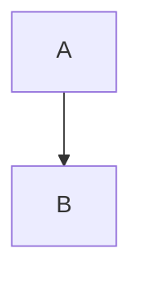

# MarkdownEditor

Componente React para visualizar y editar contenido Markdown (GFM) con dos vistas
sincronizadas: **renderizada (WYSIWYG)** y **Markdown/texto fuente**. El Markdown es la única
fuente de verdad: toda edición en cualquiera de las vistas actualiza ambas representaciones.

## Propósito

Editar documentos Markdown sin conocer la sintaxis (vía barra de herramientas) sin perder nunca
el acceso al texto fuente real. Pensado como componente de librería: sin lógica de aplicación,
sin persistencia (la app consumidora decide cómo guardar) y sin dependencias de frameworks de
aplicación.

## Instalación y uso

```tsx
import { MarkdownEditor } from "mdwysiwyg";
import "mdwysiwyg/styles.css";

function App() {
  return (
    <MarkdownEditor
      initialContent={"# Hola\n\nEscribe **aquí**.\n"}
      onChange={(markdown) => console.log(markdown)}
    />
  );
}
```

Sin `initialContent` el editor comienza vacío. Sin `width`/`height` usa 700×500px.

Cada prop está documentada en el propio código (JSDoc): al pasar el cursor sobre ella en tu editor ves qué hace, sus
valores, su default, si se puede cambiar en caliente y cómo se relaciona con las demás. Para el aspecto visual, ver
[Cómo implementar estilos en tu host](../../../docs/THEMING.md).

## API (props)

| Prop | Tipo | Default | Descripción |
| --- | --- | --- | --- |
| `initialContent` | `string` | `""` | Markdown (GFM) inicial. No es controlado: cambios posteriores de la prop no reinician el editor. |
| `onChange` | `(markdown: string) => void` | — | Invocado con el Markdown actualizado tras **cada** modificación, desde cualquiera de las dos vistas. No se invoca al alternar de vista sin editar. |
| `width` | `number \| string` | `700` | Ancho (número = px, string = CSS). |
| `height` | `number \| string` | `500` | Alto (número = px, string = CSS). |
| `sanitizeEmbeddedHtml` | `boolean` | `true` | Sanitiza el HTML embebido antes de renderizarlo en la vista WYSIWYG (elimina `<script>`, handlers inline y demás vectores XSS). Desactivar solo con contenido de confianza. |
| `className` | `string` | — | Clase adicional para el contenedor raíz. |
| `onlyView` | `boolean` | `false` | Arranca en modo de solo lectura: ninguna vista es editable, la barra muestra "Edición desactivada" y conserva solo el control de exportar. |
| `showToolbar` | `boolean` | `true` | Muestra u oculta la barra de herramientas (también la barra reducida de `onlyView`). Se puede cambiar en cualquier momento sin perder contenido, cursor ni historial. Oculta, no hay botón de vista Markdown ni Export. |
| `mode` | `"default" \| "compare"` | `"default"` | `"compare"` muestra el contenido original y un contenido nuevo lado a lado (o arriba y abajo) con las diferencias resaltadas. Requiere también `compareContent` (si falta, se comporta como `"default"`); la orientación es `"side-to-side"` salvo que indiques `compareOrientation`. Ver [Modo comparación](#modo-comparación). |
| `compareOrientation` | `"side-to-side" \| "up-and-down"` | `"side-to-side"` | Disposición de los paneles en modo `"compare"`: original a la izquierda/arriba y nuevo (editable) a la derecha/abajo, mitad y mitad. |
| `compareContent` | `string` | — | Markdown nuevo (propuesto) del panel editable en modo `"compare"`. Es también la referencia de "Restaurar". |
| `onCompareDecision` | `(result: { decision: "accepted" \| "rejected"; markdown: string }) => void` | — | Se invoca una vez cuando el usuario acepta o rechaza el cambio; `markdown` es el contenido resultante. El componente vuelve por sí mismo al modo normal. |
| `historyUndo` | `boolean` | `false` | Activa el historial de versiones: se guarda una versión tras 3 s sin cambios y un icono tras el botón HTML de la barra abre el modo historial (Undo / Redo / Confirm / Cancel (back to last version) y una lista de versiones con su hora). Solo en modo `"default"` y sin `onlyView`. Se puede cambiar en cualquier momento. Ver [Historial de versiones](#historial-de-versiones). |
| `compareSyncScroll` | `boolean` | `true` | En modo `"compare"`, mantiene los dos paneles sobre el mismo contenido al desplazarse (ver «Desplazamiento sincronizado»). Con `false` se desplazan por separado. Se puede cambiar en cualquier momento. |
| `resizable` | `boolean` | `true` | Permite redimensionar el componente arrastrando su esquina inferior derecha (como un `<textarea>` nativo). Con `false`, el tamaño queda fijo. Se ignora con `autoHeight`. |
| `autoHeight` | `boolean` | `false` | Alto automático: el componente crece hacia abajo con su contenido, sin barra de desplazamiento vertical interna (ver «Alto automático»). `height` pasa a ser el mínimo y no hay tirador de redimensionar. Se puede cambiar en cualquier momento. |
| `autoHideBar` | `boolean` | `false` | Oculta la barra de herramientas mientras el foco está fuera del componente y la muestra al volver (ver «Ocultar la barra al perder el foco»). `showToolbar={false}` tiene prioridad. Se puede cambiar en cualquier momento. |
| `onlyViewNotice` | `string` | `"Edición desactivada"` | Texto del aviso mostrado en la barra con `onlyView` activo. Útil para mostrar, por ejemplo, el nombre del archivo. |
| `documentId` | `string` | — | Identificador de documento de uso libre para la app consumidora. El componente lo acepta sin darle un uso propio. |
| `resolveImageSrc` | `(src: string) => string` | — | Resuelve el `src` de las imágenes **solo para mostrarlas** (p. ej. ruta relativa → URL servible). El Markdown conserva el `src` original. Debe pasarse desde el montaje (activarlo o no después no tiene efecto). |
| `fileName` | `string` | — | Nombre de archivo de uso libre para la app consumidora. No se usa automáticamente como `onlyViewNotice`: pasalo explícitamente si lo querés ahí. |

Tipos exportados: `MarkdownEditorProps`, `MarkdownEditorHandle`, `EditorMode`, `CompareOrientation`, `CompareDecision`.

## API imperativa (`ref`)

El componente acepta una `ref` que expone métodos para controlarlo desde la aplicación:

```tsx
import { useRef } from "react";
import { MarkdownEditor } from "mdwysiwyg";
import type { MarkdownEditorHandle } from "mdwysiwyg";

function Editor() {
  const ref = useRef<MarkdownEditorHandle>(null);

  return (
    <>
      <MarkdownEditor ref={ref} initialContent="# Original" />
      <button onClick={() => ref.current?.reset()}>Descartar cambios</button>
      <button onClick={() => alert(ref.current?.isModified())}>¿Modificado?</button>
    </>
  );
}
```

| Método | Devuelve | Descripción |
| --- | --- | --- |
| `reset()` | `void` | Restablece el contenido al valor con el que se montó el componente, en ambas vistas. En modo comparación equivale a "Restaurar" (vuelve a `compareContent` y notifica `onChange`). |
| `isModified()` | `boolean` | `true` si el contenido actual difiere del original. Vuelve a `false` tras `reset()`. En modo comparación es `true` exactamente cuando "Restaurar" es visible. |
| `insertMarkdown(markdown)` | `void` | Inserta Markdown en el cursor (reemplaza la selección). En la vista Markdown inserta en la selección del textarea. Invoca `onChange`. |
| `setMarkdown(markdown)` | `void` | Reemplaza todo el contenido como un cambio **deshacible** en la vista renderizada (Ctrl+Z restaura el anterior; en la vista Markdown se usa el deshacer nativo del textarea, que no lo incluye). No cambia la base de `isModified()`. Invoca `onChange`. |

## Barra de herramientas

- **Formato**: párrafo, encabezados H1–H6, negrita, cursiva, tachado.
- **Listas**: ordenada, con viñetas, de tareas (checklist), y sangría para anidar. Los botones
  de aumentar/disminuir sangría se ocultan (no solo se deshabilitan) cuando la acción no está
  disponible para la posición actual del cursor.
- **Bloques**: bloque de código con resaltado de sintaxis y selector de lenguaje (JSON, SQL,
  TypeScript, JavaScript, Java u "Otro…" para especificar cualquier otro), cita, línea horizontal.
- **Insertar**: imagen (por URL), enlace, tabla (selector visual de tamaño: cuadrícula 10×10,
  convención columnas × filas — "3 × 4" = 3 columnas y 4 filas), HTML embebido.
- **`</>`**: alterna entre vista renderizada y vista Markdown. Alternar nunca modifica el
  contenido, y el cursor se reposiciona en el punto equivalente de la vista destino.
- **Export** (icono de descarga, alineado al extremo derecho de la barra): copia al portapapeles
  como Markdown o como HTML.

La barra se mantiene en una sola fila: si el espacio disponible es insuficiente, el selector de
encabezado se encoge (hasta 30px de ancho mínimo) antes que cualquier otro control.

### Mostrar y ocultar la barra

`showToolbar` (por defecto `true`) permite al host mostrar u ocultar la barra en caliente:

```tsx
const [showToolbar, setShowToolbar] = useState(true);
<MarkdownEditor showToolbar={showToolbar} />
```

Al ocultarla desaparece del layout y del árbol de accesibilidad (el área de contenido ocupa su
espacio; el tamaño del componente no cambia), se cierran sus paneles abiertos sin aplicar acciones y,
si un control de la barra tenía el foco, este pasa al editor. Contenido, cursor, historial de
deshacer y vista (renderizada/Markdown) no cambian, y alternar la prop nunca dispara `onChange`. Los
atajos de teclado, los menús de tabla, el popover de enlaces y la API imperativa siguen funcionando.
Mientras está oculta no hay botón de vista Markdown ni Export.

### Ocultar la barra al perder el foco

Con `autoHideBar` (por defecto `false`) la barra solo se ve mientras el usuario trabaja en el componente:

```tsx
<MarkdownEditor autoHideBar />
```

- Empieza oculta si el foco no está dentro; aparece al hacer clic o tabular hacia el contenido y desaparece cuando el
  foco sale (clic en otro lugar, Tab a otro campo, cambio de ventana).
- Moverse entre el contenido, la barra y sus menús, diálogos o popovers **no** la oculta: cuentan como "dentro".
- Oculta = fuera del layout (el contenido ocupa su espacio) y fuera del orden de tabulación: con Tab se entra al
  contenido y, ya visible, Shift+Tab llega a la barra. Al salir tabulando, el foco sigue el orden normal de la página.
- `showToolbar={false}` manda (nunca la muestra). La barra de comparación y la del historial no se ocultan: llevan
  decisiones pendientes.
- Cambiar la prop no toca contenido, cursor ni historial y nunca dispara `onChange`.

### Alto automático

Con `autoHeight` (por defecto `false`) el componente crece hacia abajo hasta mostrar todo su contenido, sin barra de
desplazamiento vertical interna, y empuja hacia abajo lo que hay debajo en la página:

```tsx
<MarkdownEditor autoHeight height={240} />
```

- `height` pasa a ser el alto **mínimo**: con poco contenido el control conserva ese alto; al borrar vuelve a él.
- Sin tope: un documento largo hace crecer el control y se desplaza la página. Si querés un máximo, limitá el
  contenedor del host (por ejemplo `max-height` + `overflow: auto` en un padre).
- Funciona en ambas vistas (en la Markdown, el área de texto se ajusta a sus líneas, incluidas las ajustadas), en
  comparación (lado a lado: alto del panel más alto; arriba y abajo: ambos completos), con `onlyView` y en el
  historial (la lista de versiones se desplaza por su cuenta y no agranda el control).
- No se ofrece el tirador de redimensionar (`resizable` se ignora) mientras esté activo.
- Solo desaparece la barra vertical: tablas anchas o líneas de código largas siguen con desplazamiento horizontal.
- Se puede cambiar en cualquier momento sin perder contenido, cursor ni historial.

### Modo comparación

Con `mode="compare"` y `compareContent` (y opcionalmente `compareOrientation`, por defecto `"side-to-side"`), el componente muestra el contenido
**original** (el que tenía al empezar la comparación; en un montaje nuevo, `initialContent`) y el
contenido **nuevo** que le pasas, para que el usuario decida qué hacer:

```tsx
<MarkdownEditor
  initialContent={current}
  mode="compare"
  compareOrientation="side-to-side" // o "up-and-down"
  compareContent={proposal}
  onChange={(markdown) => setDraft(markdown)}
  onCompareDecision={({ decision, markdown }) => {
    // decision: "accepted" | "rejected"; markdown: contenido que queda en el editor
    save(decision === "accepted" ? markdown : current);
  }}
/>
```

- **Paneles**: original a la izquierda (`side-to-side`) o arriba (`up-and-down`), nuevo a la derecha o
  abajo, cada uno con la mitad del espacio. Solo el panel **nuevo** es editable (con toda la barra de
  herramientas, atajos, menús de tabla y popover de enlaces); el original es de solo lectura. Con
  `onlyView` ambos lo son. El botón `</>` alterna ambos paneles entre vista renderizada y código Markdown.
- **Diferencias**: lo que en el panel nuevo es nuevo o distinto respecto del original tiene fondo amarillo
  (`<mark>`): a nivel de palabra dentro de párrafos, encabezados, celdas y elementos de lista (también un
  cambio solo de formato, p. ej. una palabra en negrita); elementos enteramente nuevos (párrafo, elemento de
  lista, fila de tabla, bloque de código) se resaltan completos; en bloques de código y Mermaid, las líneas
  cambiadas. El resaltado se recalcula al editar. Lo eliminado no se marca (se ve en el panel original). El
  panel nuevo se describe para lectores de pantalla con el número de diferencias.
- **Barra de comparación** (bajo la barra de herramientas): **Rechazar cambio**, **Aceptar cambio** (ambos
  deshabilitados si no hay diferencias) y **Restaurar**, que solo aparece cuando el panel nuevo difiere de
  `compareContent` y lo devuelve a ese contenido (notifica `onChange`). Si ocultas las barras con
  `showToolbar={false}`, la barra de comparación se oculta también y el host debe ofrecer su propia
  forma de decidir.
- **Aceptar / Rechazar**: se invoca `onChange` y luego `onCompareDecision` con el Markdown resultante
  (aceptar: el contenido actual del panel nuevo, incluidas las ediciones manuales; rechazar: el original) y
  el componente vuelve al modo normal mostrándolo. No reinicia la comparación hasta que el host salga del
  modo (`mode="default"`) y vuelva a entrar, o pase otro `compareContent`.
- **En tiempo real**: puedes cambiar `mode`, `compareOrientation` o `compareContent` con el componente
  montado. Cambiar la orientación conserva el panel nuevo (con sus ediciones); otro `compareContent`
  reemplaza el panel nuevo y descarta las ediciones, manteniendo el original; pasar a `"default"` deja el
  contenido del panel nuevo en el editor. Ninguno de estos cambios dispara `onChange`.
- **`onChange` y API imperativa**: en comparación `onChange` informa del Markdown del panel nuevo.
  `reset()` equivale a "Restaurar" e `isModified()` es `true` exactamente cuando "Restaurar" es visible.
- **Tema**: `--mdw-compare-highlight-bg` (por defecto `#fff176`) es el color del resaltado.
- **Desplazamiento sincronizado** (`compareSyncScroll`, por defecto `true`): al desplazar un panel, el otro
  muestra el contenido que corresponde al borde superior del panel que se mueve. La correspondencia sale de
  las mismas diferencias que se resaltan (vista renderizada: bloques idénticos o muy parecidos; vista
  Markdown: líneas idénticas, medidas con su ajuste de línea), así que los bloques añadidos o eliminados
  antes no desalinean los paneles. Un tramo que solo existe en un lado se recorre de forma proporcional hasta
  el siguiente contenido común; sin contenido común se sigue el progreso proporcional, y arriba/abajo de un
  panel llevan al otro arriba/abajo. Guía el panel que se desplazó en último lugar (rueda, barra, teclado o
  cursor al escribir); escribir en el panel nuevo nunca lo mueve. Solo es vertical, funciona en ambas
  orientaciones y vistas, no usa animación y se recoloca al cambiar el contenido, la vista, la orientación o
  el tamaño. Con `compareSyncScroll={false}` los paneles son independientes; al volver a activarla el otro
  panel se alinea con el que se desplazó en último lugar. No altera contenido, cursor ni `onChange`.
- **Límites**: sin aceptar/rechazar diferencias sueltas, sin navegación
  entre diferencias. En la vista Markdown se comparan los textos tal cual, así que un Markdown no canónico
  (p. ej. `* a` frente a `- a`) puede contar como diferencia allí y no en la vista renderizada.

### Historial de versiones

Con `historyUndo` (por defecto `false`) el componente guarda versiones del documento y permite recorrerlas:

```tsx
<MarkdownEditor historyUndo onChange={save} />
```

- **Versiones**: la primera es el contenido al empezar a grabar. Tras cualquier cambio y 3 s de inactividad se
  guarda una nueva versión con su hora; una ráfaga de cambios con pausas menores de 3 s genera una sola, y no
  se guarda si el contenido es igual a la última. Se conservan como máximo 200 (se descartan las más
  antiguas). Viven en memoria: no se persisten y se pierden al desmontar el componente.
- **Icono**: un reloj con flecha antihoraria, situado justo tras el botón HTML (Export queda aparte, a la derecha). Solo con
  `historyUndo`, en modo `"default"`, sin `onlyView` y con la barra visible. Al pulsarlo se guarda antes
  cualquier cambio pendiente y se abre el **modo historial**; volver a pulsarlo equivale a **Cancel (back to last version)**.
- **Modo historial**: aparece una barra bajo la barra de herramientas con **← Undo**, **Redo →**,
  **Confirm** y **Cancel (back to last version)**, y a la derecha una lista de versiones (la más reciente arriba) con su
  hora `hh:mm:ss`; la versión mostrada se marca (negrita y viñeta) y se mantiene a la vista. Pulsar una
  entrada (ratón, Enter o Espacio) lleva a esa versión y muestra su contenido; Undo/Redo siguen desde ahí. Undo/Redo
  cambian el documento a la versión anterior/siguiente en cualquier vista (rendered o Markdown) sin llamar a
  `onChange`. Están deshabilitados (`aria-disabled`, el foco no se pierde) en la primera/última versión.
  `Ctrl/Cmd+Z` es Undo y `Ctrl/Cmd+Shift+Z` o `Ctrl+Y` es Redo mientras el modo está abierto.
- **Solo lectura**: mientras se recorre el historial el documento no se puede modificar (teclado, barra,
  menú de tabla, popover de enlaces); el botón de vista Markdown y Export siguen disponibles.
- **Confirm**: conserva la versión mostrada y cierra el modo. Llama a `onChange` una vez si difiere del
  contenido que había al abrir; si difiere de la última versión se añade como la más reciente (las versiones
  posteriores se conservan: el historial nunca se reescribe).
- **Cancel (back to last version)**: restaura exactamente el contenido que había al abrir el modo, sin llamar a `onChange`.
- **Cierres forzados** (equivalen a Cancel (back to last version)): `historyUndo` pasa a `false` (además se descartan las
  versiones), `onlyView`, comenzar un modo `"compare"` (la comparación usa el contenido previo como original),
  ocultar la barra con `showToolbar={false}`, y las llamadas imperativas `setMarkdown`, `insertMarkdown` y
  `reset` (que se aplican después). Con el modo abierto, `isModified()` compara el contenido previo.
- **Accesibilidad**: el icono es un botón con `aria-pressed`; la barra es un `toolbar` etiquetado; la lista es
  una `nav` con `aria-current` en la versión mostrada y una región `status` anuncia «Versión n de m — hora».
- **Límites**: plazo (3 s) y tope (200) fijos; sin persistencia, sin nombrar ni comparar versiones. El deshacer nativo del editor (`Ctrl+Z` fuera del modo historial) es
  independiente de este historial.

### Tablas

Al pasar el puntero sobre una celda aparece un pequeño **triángulo en su esquina superior
derecha**. Un clic sobre el triángulo (el puntero cambia al de enlace) abre un menú de acciones
estructurales:

- **Celda de encabezado** → menú de columna: añadir a la derecha/izquierda, mover a la
  derecha/izquierda, eliminar esta columna.
- **Celda de datos** → menú de fila: añadir arriba/abajo, subir/bajar esta fila, eliminar esta
  fila.

Las acciones se aplican a la celda cuyo triángulo se pulsó, sin necesidad de hacer clic antes en
ella. Hacer clic de nuevo en una celda ya activa **no** abre el menú: solo reposiciona el cursor.
Con el teclado, con el cursor dentro de una celda, la tecla **Menú contextual** o **Mayús+F10**
abre el mismo menú. Mover una columna/fila más allá del borde de la tabla no tiene efecto. El
triángulo no aparece con `onlyView` ni en la vista Markdown, y nunca forma parte del Markdown
resultante. El color y el tamaño se personalizan con `--mdw-table-menu-trigger-color` (por
defecto el de la scrollbar) y `--mdw-table-menu-trigger-size` (por defecto `0.7em`, ≈ la mitad
de la altura del cursor de texto).

### Cursor y líneas entre bloques

Un clic en el área libre **a la derecha de una tabla** (a la altura de cualquiera de sus filas),
en su margen, o en el **hueco entre dos bloques** (tabla, código, diagrama…) posiciona el cursor
entre ambos en vez de dentro de una celda o del bloque. Se muestra como un cursor horizontal (de
hueco); **Enter** inserta ahí una línea en blanco y escribir añade texto en ese punto. Un clic en
el margen superior de una tabla permite escribir antes de ella. Con una línea vacía ya presente
junto al hueco, el cursor entra directamente en ella.

Si el documento termina en un bloque (tabla, código, Mermaid, cita, lista, regla horizontal,
imagen), la vista renderizada mantiene siempre un párrafo vacío después de él, y un clic a su
derecha o debajo coloca el cursor ahí. Con el teclado, la flecha abajo / Ctrl+Fin desde el último
bloque llega al mismo punto. Un clic *dentro* de una celda, del código o del diagrama conserva su
comportamiento.

Estas líneas auxiliares no emiten `onChange` al crearse, no entran en el historial de deshacer y no
alteran el Markdown mientras estén vacías. No se aplican en `onlyView`.

### Diagramas Mermaid

Un bloque de código con lenguaje `mermaid` se renderiza como diagrama en la vista renderizada:

````markdown

````

Con sintaxis inválida, el bloque degrada al texto del código sin romper el documento. Al usar
**Insertar HTML**, si el contenido pegado es en realidad sintaxis Mermaid, se inserta como bloque
de código `mermaid` en lugar de HTML embebido. El renderizado es puramente visual: el Markdown
fuente nunca se altera.

La librería de Mermaid se carga de forma perezosa (solo cuando aparece un diagrama), por lo que no
pesa en el bundle de quien no la usa, y se configura con `securityLevel: "strict"` (HTML escapado
en etiquetas, sin callbacks de clic) por tratarse de contenido potencialmente no confiable.

### Enlaces

Si hay texto seleccionado al presionar "Insertar enlace", el diálogo pide solo la URL y la aplica
sobre ese texto sin modificarlo. Sin selección, pide URL y texto (como cualquier inserción).
Cualquier URL sin protocolo (sin `"://"`) recibe automáticamente el prefijo `http://` — tanto al
insertar como al editar un enlace ya existente.

Hacer clic sobre un enlace en la vista renderizada abre un panel con **Ir a la url**, **Copiar
url**, y **Editar url** (que muestra un campo con la URL actual, **Eliminar link**, y **Guardar**).
En modo `onlyView` el panel solo ofrece "Ir a la url" y "Copiar url" — sin edición.

## Theming (CSS Custom Properties)

El aspecto se personaliza con CSS estándar declarando variables `--mdw-*`, sin props de estilo:

```css
.mi-editor { --mdw-bg: #0b1220; --mdw-fg: #e5e7eb; --mdw-accent: #60a5fa; }
```

```tsx
<MarkdownEditor className="mi-editor" />
```

- Se pueden declarar en la clase del control, en cualquier contenedor o en `:root` (prioridad: clase del control >
  ancestro > default). Funcionan en cualquier orden de carga de las hojas y sin `!important`.
- Hay variables para barra, contenido, tablas, código y resaltado de sintaxis, citas, botones, menús y popovers,
  comparación y scroll (47 en total).

La lista completa con defaults, recetas (tema oscuro, preferencia del sistema, color de marca, fuentes, barra plana,
fondo), qué está soportado y la resolución de problemas están en
**[Cómo implementar estilos en tu host](../../../docs/THEMING.md)**.

## Ejemplos

```tsx
// Vacío, tamaño propio, notificación de cambios
<MarkdownEditor width="100%" height={400} onChange={save} />

// HTML embebido de confianza sin sanitizar
<MarkdownEditor
  initialContent={'<div class="widget">…</div>'}
  sanitizeEmbeddedHtml={false}
/>

// Visor de solo lectura, sin control de redimensionamiento
<MarkdownEditor
  onlyView
  resizable={false}
  initialContent={documentoExistente}
/>
```

## Casos relevantes y límites conocidos

- **Alternancia sin pérdida**: alternar de vista sin editar preserva el texto fuente byte a byte,
  incluso con formato no canónico (p. ej. `*   item`).
- **Normalización al editar**: tras editar en la vista WYSIWYG, el Markdown se reserializa en
  forma canónica (viñetas `-`, negrita `**`, fences ``` para código). El contenido semántico se
  preserva; el estilo de escritura puede normalizarse.
- **Markdown inválido o incompleto**: la vista Markdown conserva el texto tal cual; la vista
  renderizada muestra la mejor interpretación posible sin bloquear ni perder contenido.
- **HTML embebido**: los bloques HTML (línea propia, separados por líneas en blanco) se preservan
  byte a byte y se muestran sanitizados por defecto. El HTML *inline* dentro de un párrafo se
  degrada a texto visible (no se ejecuta) y puede quedar escapado si se edita en WYSIWYG.
- **Enlaces**: el popover de edición solo está disponible en la vista renderizada; en la vista
  Markdown, un enlace es texto plano y se edita directamente como tal. El autocompletado de
  protocolo (`http://`) no valida que la URL exista ni sea alcanzable, solo su formato.
- **Imágenes**: por referencia (URL). Si la URL no carga, el navegador muestra el `alt`; la
  referencia se conserva en el Markdown.
- **Escala**: pensado para documentos de tamaño típico de notas/documentación personal; no hay
  virtualización para documentos masivos.
- **Líneas en blanco finales**: el Markdown estándar no representa líneas en blanco múltiples de
  forma semántica; las líneas vacías tras el último bloque existen en la vista renderizada pero no
  se serializan. El texto escrito en ellas sí se conserva. Las tablas anidadas dentro de citas o
  listas no tienen este acceso por clic.
- **Persistencia**: fuera del alcance del componente — usa `onChange` para guardar donde decidas.
- **Resaltado de sintaxis**: aplica a los 5 lenguajes del selector (JSON, SQL, TypeScript,
  JavaScript, Java); un lenguaje personalizado no reconocido se muestra en texto plano legible,
  sin error. Es puramente visual — nunca modifica el Markdown fuente ni el fence info string.
- **Redimensionamiento**: el tamaño resultante de arrastrar la esquina es efímero (no se persiste
  entre sesiones); si tu app necesita recordarlo, escuchá el resize por tu cuenta (por ejemplo con
  un `ResizeObserver` externo) y volvé a pasar `width`/`height` en el próximo montaje.
- **Posición del cursor al alternar**: es una correspondencia de mejor esfuerzo. Cuando la
  sintaxis Markdown no tiene reflejo en el texto renderizado (marcadores como `**`, `#`, `|`), el
  cursor cae en la aproximación más cercana, no en una coincidencia exacta de carácter.
- **Mermaid**: los diagramas se renderizan con `securityLevel: "strict"`. La detección al insertar
  HTML usa un filtro de palabras clave antes de validar con el parser de Mermaid, para no cargar
  la librería al pegar HTML común.
- **`reset()` / `isModified()`**: comparan contra el contenido con el que se **montó** el
  componente. `initialContent` no es una prop controlada: cambiarla después del montaje no
  redefine ese valor de referencia.
